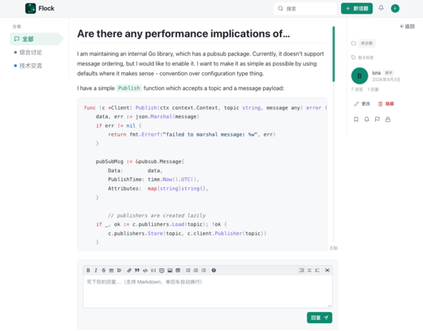

# Flock · 极简论坛

Flock 是一个用 Go + React 构建的轻量级论坛系统，采用前后端分离架构。
后端基于 Echo 提供 RESTful API，数据层使用 goent 做轻量 ORM，默认使用纯 Go 的
SQLite 存储（无需 CGO）；前端使用 React + Chakra UI，支持 Markdown 编辑与渲染。

它借鉴了 Discourse 的「话题 + 首帖」模型：一个话题（Topic）由若干帖子（Post）组成，
首帖（`PostNumber=1`）即楼主正文，后续楼层为回复。整体界面为柔和的「水粉画」风格，
适合搭建小型技术社区、内部讨论区或学习示例项目。



## 目录

- [主要功能](#主要功能)
- [技术栈](#技术栈)
- [项目结构](#项目结构)
- [环境要求](#环境要求)
- [安装与运行](#安装与运行)
- [使用示例](#使用示例)
- [截图说明](#截图说明)
- [API 概览](#api-概览)
- [配置项](#配置项)
- [常见问题](#常见问题)

## 主要功能

**内容与互动**

1. 话题（Topic）发布、编辑、删除，支持置顶、关闭、隐藏。
2. 帖子（Post）按楼层回复，支持编辑、删除、点赞、顶 / 踩评分。
3. 分类（Category）过滤与标签（Tag）体系，标签会统计话题数量并展示热门标签。
4. 收藏（Bookmark）、关注话题（Follow）、举报（Report）内容。

**用户与权限**

5. 注册 / 登录（JWT 鉴权），支持个人资料修改、头像与简介。
6. 三种角色：`admin`（管理员）、`moderator`（版主 / 管理）、`user`（普通用户）。
7. 个人主页展示用户发布的话题与帖子。

**检索与通知**

8. 全文检索：基于 SQLite FTS5（trigram 分词），索引话题标题与首帖摘要，按相关度（bm25）排序。
9. 通知中心：回复、@提及、点赞、关注、举报等事件通知，支持未读计数与实时推送（SSE）。

**管理后台**

10. 管理分类、用户（启用 / 禁用 / 改角色）、处理举报。

**其他**

11. 内置 Markdown 编辑器：`<textarea>` + 实时预览，渲染使用 `marked`（开启 `breaks` 实现单回车换行）+ `highlight.js` 代码高亮。
12. 内置演示数据：首次启动自动创建管理员、分类以及带标签的示例话题。
13. 附带 `import-so` 命令行工具，可从 StackOverflow CSV 批量导入问答数据。

## 技术栈

| 层次 | 技术 |
| --- | --- |
| 后端框架 | [Echo v5](https://github.com/labstack/echo) |
| ORM / 数据 | [goent](https://github.com/azhai/goent)、SQLite（`modernc.org/sqlite`，纯 Go） |
| 认证 | `golang-jwt/jwt/v5` + `bcrypt` 密码哈希 |
| 配置 | [gobus/environ](https://github.com/azhai/gobus)（`.env` 加载） |
| 前端 | Mithril.js、`m.route` 路由、模块级 store（mithril `m.redraw()`） |
| UI | Construct UI（Mithril 组件库，基于 Blueprint 风格）、自绘组件 + 品牌水粉主题 |
| Markdown | `marked`（开启 `breaks` + `gfm`）+ `highlight.js` 代码高亮 |
| 构建 | Go `go build`（CGO 关闭）、Vite 5 |

## 项目结构

```
flock/
├── main.go              # 程序入口：加载配置、初始化数据库、播种数据、启动服务
├── config/              # 配置读取与常量（端口、API 前缀、排序方式等）
├── models/              # 数据模型、表结构、数据库连接、全文检索
├── handlers/            # HTTP 处理器（话题、帖子、用户、通知、举报等）
├── middleware/          # 鉴权、管理员校验、可选登录等中间件
├── routes/              # API 路由注册
├── helpers/             # 通用辅助函数（如 slugify）
├── cmd/
│   └── import-so/       # 从 StackOverflow CSV 导入数据的小工具
├── web/                 # 前端工程（Mithril.js + Vite）
│   ├── src/
│   │   ├── pages/       # 页面：首页、话题详情、发帖、登录注册、个人主页、后台
│   │   ├── components/  # 组件：头部、侧栏、分页、代码块、标签输入
│   │   └── lib/         # API 封装、状态管理、高亮等
│   └── vite.config.js   # 前端构建与开发代理配置
├── example.env          # 环境变量示例
├── Makefile             # 常用构建 / 运行 / 测试命令
└── screenshot.png       # 界面截图
```

## 环境要求

- **Go 1.27+**（见 `go.mod`）
- **Node.js 18+** 与 **npm**
- 无需安装数据库，默认使用文件型 SQLite

> **本地依赖说明**：`go.mod` 中通过 `replace` 指令将 `github.com/azhai/gobus`
> 和 `github.com/azhai/goent` 指向本地同级目录（`../gobus`、`../goent`）。
> 因此克隆本项目时，请确保这两个仓库放在 `flock` 的同级目录下。

## 安装与运行

### 1. 准备配置文件

复制示例配置并按需修改：

```bash
cp example.env .env
```

`.env` 内容示例：

```dotenv
APP_MODE=debug
SERVER_PORT=8080
BASE_URL=http://127.0.0.1:8080
SITE_TITLE=Flock
SITE_DESCRIPTION=一个极简论坛
JWT_SECRET=change-me-in-production
TOKEN_EXPIRY=72
ADMIN_USERNAME=admin
ADMIN_PASSWORD=admin123
ADMIN_EMAIL=admin@flock.local
```

> 生产环境务必修改 `JWT_SECRET` 与 `ADMIN_PASSWORD`。

### 2. 安装前端依赖

```bash
cd web && npm install && cd ..
```

### 3. 一键启动（推荐）

前端构建产物会被嵌入 Go 二进制，直接运行即可访问完整站点：

```bash
make run
```

该命令会先执行前端构建（`vite build`），再运行后端 `go run ./`。
启动后访问 **http://127.0.0.1:8080**。

### 4. 开发模式（前后端热更新）

```bash
make dev
```

此命令会：

1. 安装 `air`（Go 热重载工具，若未安装）；
2. 启动 Vite 开发服务器（默认 http://127.0.0.1:5173）；
3. 用 `air` 启动后端并监听 `.go` 文件变化。

开发时请访问 Vite 端口 **5173**，前端会通过代理把 `/api/v1` 请求转发到后端。

### 5. 编译为二进制

```bash
make one     # 本地单平台构建，产物在 bin/flock
make all     # 清理 + 本地构建 + 五平台交叉编译
```

编译并直接运行后端（不构建前端）：

```bash
make server
```

### 6. 运行测试

```bash
make test    # go test -race + 覆盖率
make cover   # 生成覆盖率 HTML 报告并在浏览器打开
make lint    # golangci-lint 静态检查
```

## 使用示例

### 示例一：注册与登录

1. 打开站点，点击右上角 **注册**，填写用户名、邮箱与密码完成注册。
2. 使用相同账号在 **登录** 页登录，登录态通过 JWT 保存（默认有效期 72 小时）。
3. 登录后右上角显示头像与通知铃铛。

### 示例二：发布话题与回复

1. 在首页点击 **+ 新建话题**（或访问 `/new`）。
2. 填写标题，选择分类，输入标签，使用 Markdown 编辑器编写正文。
3. 提交后跳转到话题详情页 `/topics/:id`。
4. 在页面底部编辑框输入内容并点击 **回复**，即可追加楼层。

### 示例三：搜索与筛选

1. 顶栏搜索框输入关键词，进入带 `?q=` 参数的首页。
2. 左侧栏选择 **分类** 或 **标签** 进一步过滤（条件会同步到 URL，刷新不丢失）。
3. 首页顶部可切换排序：**最新 / 活跃 / 热门 / 获赞**。

### 示例四：收藏、关注与通知

1. 话题详情页右侧栏可 **收藏** 或 **关注** 该话题。
2. 被回复、被点赞、被提及时，通知铃铛会出现未读提示。
3. 在 `/bookmarks` 查看已收藏的话题。

### 示例五：管理后台

1. 使用管理员账号登录（默认 `admin` / `admin123`，可在 `.env` 中修改）。
2. 访问 `/admin` 进入管理面板。
3. 可管理分类、启用 / 禁用用户、调整用户角色、处理举报。

### 示例六：登录后使用 API

```bash
# 登录并获取 Token
curl -s -X POST http://127.0.0.1:8080/api/v1/auth/login \
  -H 'Content-Type: application/json' \
  -d '{"username":"admin","password":"admin123"}'

# 携带 Token 获取当前用户信息
curl -s http://127.0.0.1:8080/api/v1/auth/me \
  -H 'Authorization: Bearer <你的 Token>'
```

### 示例七：导入 StackOverflow 数据（可选）

准备 `SO-go-48000.csv`（字段顺序见 `cmd/import-so/main.go` 注释），然后运行：

```bash
go run ./cmd/import-so -csv SO-go-48000.csv -batch 100
```

该工具会清空帖子相关表（保留用户与分类），将「问题」导入为首帖、「被采纳答案」导入为次帖，
并在完成后重建全文检索索引。

## 截图说明

下图为**话题详情页**，展示了 Flock 的主要界面布局：


界面分为三个区域：

1. **左侧栏（分类导航）**：列出所有分类（全部 / 综合讨论 / 技术交流），点击即可筛选话题。
2. **中间主区（话题与帖子）**：顶部为话题标题，下方是楼主正文与回复楼层。
   帖子中的代码块会语法高亮，长文可按 Markdown 渲染标题、列表、引用等格式。
3. **右侧栏（操作与作者信息）**：包含收藏、分享、编辑、删除等操作按钮，
   以及话题作者的头像、名称、发布时间和统计数据。
4. **底部（回复编辑器）**：Markdown 编辑器，支持工具栏按钮与实时预览，
   输入完成后点击 **回复** 即可发布楼层。

## API 概览

所有接口以 `/api/v1` 为前缀，返回 JSON。需要鉴权的接口请在请求头携带
`Authorization: Bearer <token>`。

| 方法 | 路径 | 说明 | 鉴权 |
| --- | --- | --- | --- |
| GET | `/health` | 健康检查 | 否 |
| POST | `/auth/register` | 注册 | 否 |
| POST | `/auth/login` | 登录 | 否 |
| GET | `/categories` | 分类列表 | 否 |
| GET | `/tags` | 标签列表 | 否 |
| GET | `/topics` | 话题列表（支持 `q` / `cat` / `tag` / `sort` / `page`） | 可选 |
| GET | `/topics/:id` | 话题详情 | 可选 |
| GET | `/topics/:id/posts` | 话题帖子列表 | 可选 |
| GET | `/users/:username` | 用户资料 | 否 |
| GET | `/users/:username/topics` | 用户话题 | 否 |
| GET | `/users/:username/posts` | 用户帖子 | 否 |
| GET | `/auth/me` | 当前用户信息 | 是 |
| PUT | `/user/me` | 修改资料 | 是 |
| POST | `/topics` | 创建话题 | 是 |
| PUT | `/topics/:id` | 编辑话题 | 是 |
| DELETE | `/topics/:id` | 删除话题 | 是 |
| POST | `/topics/:id/posts` | 回复话题 | 是 |
| POST | `/topics/:id/bookmark` | 收藏 / 取消收藏 | 是 |
| POST | `/topics/:id/follow` | 关注 / 取消关注 | 是 |
| POST | `/posts/:id/like` | 点赞 / 取消点赞 | 是 |
| POST | `/posts/:id/vote` | 顶 / 踩评分 | 是 |
| POST | `/posts/:id/report` | 举报帖子 | 是 |
| GET | `/notifications` | 通知列表 | 是 |
| GET | `/notifications/unread` | 未读通知数 | 是 |
| GET | `/notifications/stream` | 通知实时推送（SSE） | 是 |
| POST | `/categories` | 创建分类 | 管理员 |
| GET | `/admin/users` | 用户列表 | 管理员 |
| GET | `/reports` | 举报列表 | 管理员 |

## 配置项

| 变量 | 默认值 | 说明 |
| --- | --- | --- |
| `APP_MODE` | `debug` | 运行模式 |
| `SERVER_PORT` | `8090`（示例为 8080） | 后端监听端口 |
| `BASE_URL` | `http://127.0.0.1:8090` | 站点基础地址 |
| `SITE_TITLE` | `Flock` | 站点标题 |
| `SITE_DESCRIPTION` | `一个极简论坛` | 站点描述 |
| `JWT_SECRET` | `change-me-in-production` | JWT 签名密钥（生产必改） |
| `TOKEN_EXPIRY` | `72` | Token 有效期（小时） |
| `ADMIN_USERNAME` | `admin` | 初始管理员用户名 |
| `ADMIN_PASSWORD` | 空 | 初始管理员密码 |
| `ADMIN_EMAIL` | `admin@flock.local` | 初始管理员邮箱 |

> 数据库连接通过 `drivers.LoadConfig` 读取，默认数据库文件为 `flock.db`。

## 常见问题

**Q：启动后页面空白或 404？**
A：确认已执行前端构建（`make run` 会自动构建；单独用 `make server` 则不会）。
`main.go` 通过 `//go:embed web/dist` 嵌入前端产物，必须先构建再编译后端。

**Q：`go build` 报找不到 `github.com/azhai/gobus` / `goent`？**
A：这两个依赖被 `replace` 到本地同级目录，请将 `gobus`、`goent` 仓库与 `flock` 放在同一父目录下。

**Q：开发模式下接口 404 或跨域？**
A：开发请访问 Vite 的 5173 端口，并确保后端已启动且 `SERVER_PORT` 与代理配置一致。

**Q：如何修改初始管理员账号？**
A：编辑 `.env` 中的 `ADMIN_USERNAME` / `ADMIN_PASSWORD`。仅当数据库中不存在该用户时才会创建。
